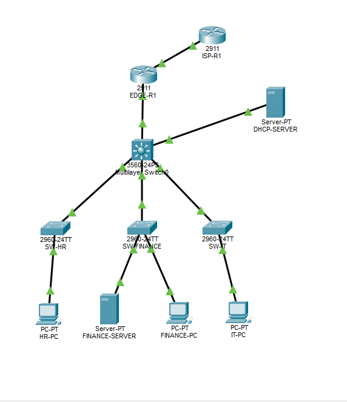

# Enterprise Networking Capstone — Cisco Packet Tracer

## Project Overview

Designed, configured, and tested a simulated enterprise network using Cisco Packet Tracer to demonstrate practical networking skills relevant to Network Support Engineer L1 and NOC Engineer L1 roles.

The network includes separate HR, Finance, and IT departments with centralized DHCP, inter-VLAN routing, OSPF dynamic routing, NAT/PAT, SSH management, and access control lists (ACLs).

## Network Topology

## Technologies Implemented

- **VLANs and Trunking:** Segmented HR, Finance, and IT departments using VLANs and configured switch uplinks.
- **Inter-VLAN Routing:** Configured Layer 3 switch virtual interfaces (SVIs) to route between departmental VLANs.
- **DHCP:** Configured centralized DHCP services and DHCP relay using `ip helper-address`.
- **OSPF:** Established an OSPF Area 0 adjacency between the core multilayer switch and edge router.
- **Static and Default Routing:** Configured routes for connectivity between the enterprise network and simulated ISP.
- **NAT/PAT:** Configured Port Address Translation on the edge router to allow internal hosts to access the simulated external network.
- **SSH:** Configured secure remote CLI management for network switches.
- **Extended ACLs:** Restricted HR-to-Finance network access while permitting authorized IT connectivity.

## IP Addressing

| VLAN | Department | Network | Gateway |
|---|---|---|---|
| 10 | HR | 192.168.10.0/24 | 192.168.10.1 |
| 20 | Finance | 192.168.20.0/24 | 192.168.20.1 |
| 30 | IT | 192.168.30.0/24 | 192.168.30.1 |
| 40 | DHCP Server | 192.168.40.0/24 | 192.168.40.1 |
| 99 | Management | 192.168.99.0/24 | 192.168.99.1 |

**Core-to-Edge:** 10.0.0.0/30

**Edge-to-ISP:** 203.0.113.0/30 (simulated external network)

## Testing and Verification

The following functions were tested successfully in Cisco Packet Tracer:

| Test | Result |
|---|---|
| DHCP address assignment to departmental PCs | Passed |
| Inter-VLAN routing | Passed |
| OSPF neighbor adjacency | Passed |
| OSPF route learning | Passed |
| NAT/PAT connectivity to simulated ISP | Passed |
| SSH remote switch management | Passed |
| HR-to-Finance ACL restriction | Blocked as intended |
| IT-to-Finance connectivity | Allowed as intended |

## Troubleshooting Experience

During implementation, investigated and resolved network configuration and connectivity issues involving VLAN interfaces, DHCP relay, ACL application, and routing verification.

Used Cisco CLI commands, ping tests, routing tables, ACL match counters, and Packet Tracer simulation to validate network behavior.

## Tools and Environment

- Cisco Packet Tracer
- Cisco 3560 multilayer switch
- Cisco 2960 access switches
- Cisco 2911 routers
- Cisco IOS CLI
- Simulated servers and end-user devices

## Project Files

- `Enterprise Networking Capstone.pkt` — Packet Tracer network simulation
- `network-topology.png` — Network topology diagram

## How to Run

1. Download the `.pkt` project file.
2. Open it using Cisco Packet Tracer.
3. Inspect the network topology and device configurations.
4. Test connectivity using PC command prompts and Cisco CLI commands.
5. Review routing, DHCP, NAT/PAT, SSH, and ACL configurations.

## Project Scope

This is a hands-on networking simulation created for practical learning, troubleshooting, and technical interview preparation. It is not a production deployment.

## Author

Vinay Raghavendra B V

Network Support Engineer L1 / NOC Engineer L1 Aspirant
